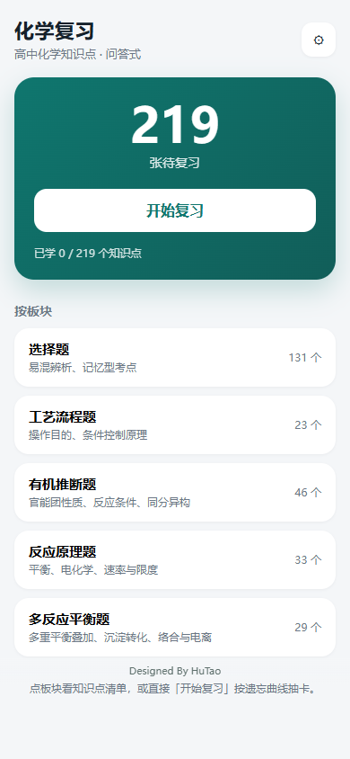
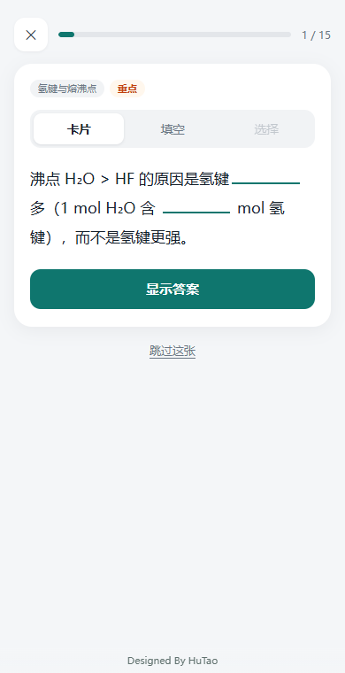
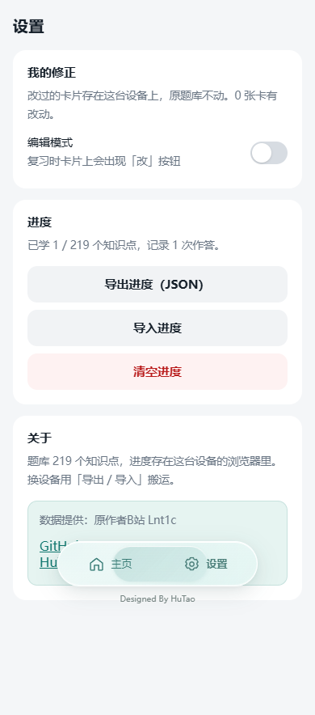

# ChemistryReview · 化学知识点复习

一个支持在线与离线复习的 Android 应用，包含 **219 个高中化学知识点**，支持卡片、填空、选择三种练习模式。

**Designed By HuTao** · 数据提供：原作者 B站 Lnt1c

[下载 APK](https://github.com/HuTaoHome/ChemistryReview/releases/latest) · [反馈问题](https://github.com/HuTaoHome/ChemistryReview/issues)

## 安装

打开 [Releases](https://github.com/HuTaoHome/ChemistryReview/releases/latest)，下载 `chemistry-review-1.0.apk`完成安装。打开“化学知识点复习”。首次启动默认使用本地数据，无需联网。

最低支持 **Android 6.0（API 23）**。可在设置中导出进度作为备份。

## 功能

- **随时选择数据来源**：顶部常驻“网站数据 / 本地数据”按钮，记住上次选择。
- **离线复习**：安装包内置题目、答案、解析及化学公式字体，断网可用。
- **三种练习模式**：卡片、填空、选择；多空卡片不提供选择模式。
- **五个板块**：选择题、工艺流程题、有机推断题、反应原理题、多反应平衡题。
- **复习计划**：按遗忘曲线抽卡，记录学习进度和作答历史。
- **题目修正**：开启编辑模式后可修改卡片，并导入、导出修正包。
- **进度备份**：通过 Android 系统文件选择器导入、导出 JSON。

## 数据来源

| 方案 | 获取方式 | 网络要求 | 更新方式 |
| --- | --- | --- | --- |
| 网站数据 | 请求原网站题库与判题接口 | 需要联网 | 读取网站当前数据 |
| 本地数据 | 读取 APK 内置快照，并在本地判题 | 无需联网 | 安装包含新快照的版本 |

当前内置快照获取于 **2026-11-27**，包含 219 个知识点。网站后续的修改不会自动写入本地快照。

切换来源会回到首页，已记录的进度和题目修正共用同一份本机存储，尚未提交的输入不保留。网站连接失败时可手动切换到本地数据。卸载或清除应用数据前，请先导出需要保留的进度。

原网页和题库来自 [chem-review-hh57.pages.dev](https://chem-review-hh57.pages.dev/)，原作者 **B站 Lnt1c**。本项目增加 Android 封装、双数据源适配、本地判题和文件导入导出，并调整应用署名。第三方题库和前端依赖的权利归各自作者所有，仓库未对这些内容另行授予许可；前端文件中保留其依赖的许可声明。

## 页面预览

以下为内置网页的移动端预览，Android 应用还会在顶部显示原生数据来源切换栏。

  
  
  

发现题目错误或应用问题，可在 [Issues](https://github.com/HuTaoHome/ChemistryReview/issues) 提交反馈。请注明应用版本、数据来源及复现步骤。
